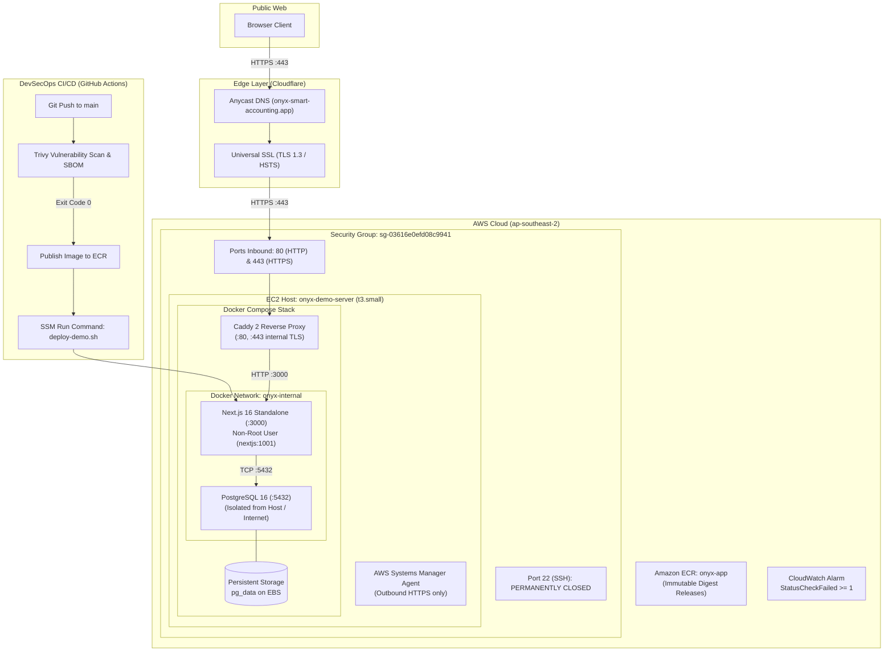

# 🧾 OnYx: Smart Accounting Platform

[](https://onyx-smart-accounting.app)
[](https://aws.amazon.com)
[](docs/security.md)
[](docs/architecture.md)

OnYx is an AI-driven financial governance platform designed to streamline accounting workflows, enforce auditability, and deliver intelligent financial insights. 

In addition to its full-stack accounting capabilities, this repository demonstrates a **hardened, end-to-end DevSecOps CI/CD delivery lifecycle**: multi-stage container optimization, automated pre-publish vulnerability gates (Trivy), CycloneDX SBOM generation, least-privilege AWS IAM boundaries, zero-SSH deployments via AWS Systems Manager (SSM), automated self-healing rollbacks, and Cloudflare Anycast edge protection.

---

## 🌐 Live Application & Infrastructure

* **Production URL:** [https://onyx-smart-accounting.app](https://onyx-smart-accounting.app)
* **Health API Endpoint:** [https://onyx-smart-accounting.app/api/health](https://onyx-smart-accounting.app/api/health)
* **AWS Region:** Sydney (`ap-southeast-2`)
* **Compute:** AWS EC2 `t3.small` (Amazon Linux 2023, Docker Engine, AWS SSM Agent)
* **Edge Proxy:** Cloudflare (Anycast DNS, Universal SSL / TLS 1.3, DDoS protection)
* **Ingress Controller:** Caddy 2 Reverse Proxy (internal TLS termination, HTTP/2)
* **Container Registry:** Amazon ECR (`onyx-app` with image immutability)

---

## 🏗️ Architecture & Network Boundaries



---

## 🛡️ DevSecOps & Security Highlights

1. **Zero-SSH Ingress**: Port 22 is permanently closed. Operators connect via AWS Systems Manager (SSM) Session Manager, providing IAM-authenticated, audit-logged shell access without private key management.
2. **Pre-Publish Vulnerability Gates**: Every release build is scanned with **Trivy** in GitHub Actions. Builds fail automatically on unmitigated `CRITICAL` or `HIGH` vulnerabilities.
3. **Hardened Minimalist Container**: Stripped package managers (`npm`, `npx`) from the production runner stage; runs under dedicated non-root user `nextjs` (UID: 1001).
4. **Supply Chain Integrity**: Generates a **CycloneDX Software Bill of Materials (SBOM)** on every publish; deployments reference immutable SHA-256 digests (`@sha256:...`) instead of mutable tags.
5. **Least-Privilege CI/CD Credentials**: GitHub Actions authenticates through a narrowly scoped IAM user restricted strictly to pushing to `onyx-app` and executing SSM commands on `i-00d2233bfd6f65be2`. All other AWS services (S3, IAM) explicitly return `AccessDenied`.
6. **Automated Self-Healing Rollback**: Post-deployment smoke tests check `/api/health`. If 15 consecutive probes fail, the deployment script autonomously restores the previous known-healthy container image digest in seconds.

---

## 🚀 DevSecOps CI/CD Pipelines

| Workflow | Trigger | Security Controls & Actions |
|---|---|---|
| **[Build & Test](.github/workflows/build-and-test.yml)** | PR / Push to `main` | Linting, TypeScript typecheck, unit/integration test suite |
| **[Security Gates](.github/workflows/security.yml)** | PR / Push to `main` | ESLint security plugins, dependency vulnerability audit |
| **[AWS Identity Verification](.github/workflows/aws-verify.yml)** | Manual dispatch | Tests STS identity, ECR token generation, negative drills (S3 & IAM denied) |
| **[Image Publish](.github/workflows/image-publish.yml)** | Push to `main` | Multi-stage Docker build, Trivy scan gate, SBOM generation, ECR push by digest |
| **[Deploy to Demo](.github/workflows/deploy-demo.yml)** | Push to `main` / Manual | Zero-SSH SSM dispatch, Docker Compose pull, `/api/health` validation, auto-rollback |

---

## 💻 Local Development

### Prerequisites
* Node.js 20+
* Docker & Docker Compose

### Running Locally
```bash
# 1. Clone repository
git clone https://github.com/DahamJ/OnYx-smart-accounting.git
cd OnYx-smart-accounting

# 2. Install dependencies
npm install

# 3. Start local development server
npm run dev -- --turbo=false
```

### Running Local Containerized Production Stack
```bash
# Build and run complete multi-container stack locally
docker compose up --build
```
Navigate to `http://localhost:3000` (or `http://localhost:3000/api/health`).

---

## 📚 Detailed Documentation & Runbooks

* [**Architecture & Threat Model**](docs/architecture.md) — Network boundaries, trust models, and IAM policies
* [**DevSecOps Operational Runbook**](docs/devsecops-runbook.md) — Incident playbooks, zero-SSH SSM procedures, and recovery drills
* [**Security Policies & Vulnerability Triage**](docs/security.md) — CVE triage records and scanner configuration
* [**Deployment & Rollback Strategy**](docs/deployment.md) — Automated rollback validation and health verification
* [**Verification Evidence Log**](docs/evidence/README.md) — Empirical drill proofs, Trivy outputs, and chaos test results
* [**Cost Control & Budget Safety**](docs/cost-control.md) — Free Tier limits, AWS Budgets, and zero-waste teardown

---

## 🧹 Infrastructure Teardown & Clean-up

To avoid unnecessary AWS charges when the demo environment is not in use:

```bash
cd infra/terraform
terraform destroy -auto-approve
```
*Note: Terraform will tear down the EC2 instance, security groups, ECR repository, and IAM policies while preserving remote state safely.*

---