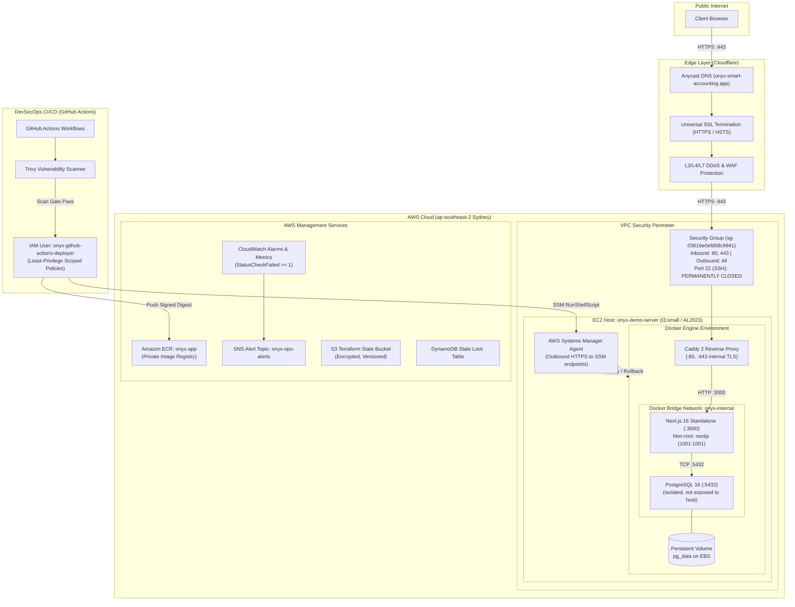

# OnYx Architecture & Security Design

This document details the system architecture, network boundaries, IAM security models, and trust perimeters for the **OnYx Smart Accounting** platform and its DevSecOps delivery pipeline.

---

## 1. High-Level Architecture Diagram



---

## 2. Ingress & Edge Protection

| Layer | Component | Function | Security Enforcement |
|---|---|---|---|
| **DNS & CDN** | Cloudflare Anycast | Authoritative DNS & Edge Routing | Proxied (`orange cloud`), masks origin EC2 public IP |
| **SSL / TLS** | Cloudflare Universal SSL | Edge TLS Termination | Enforces TLS 1.2+, modern cipher suites, and HTTPS redirection |
| **Origin TLS** | Caddy 2 Reverse Proxy | Local TLS & Ingress Routing | Generates internal trusted certificates; terminates ingress on ports 80/443; proxies to `http://app:3000` |
| **Firewall** | AWS Security Group | Network Packet Filtering | Inbound ports limited strictly to 80 and 443. Port 22 is **blocked** |

---

## 3. Container & Runtime Isolation

1. **Non-Root Execution**:
   - The application container runs as user `nextjs` (UID: 1001, GID: 1001).
   - Even if an application-layer vulnerability were exploited, the attacker does not possess root privileges inside the container.
2. **Minimalist Attack Surface**:
   - Built on `node:26-alpine`.
   - Node package managers (`npm`, `npx`, `corepack`) are purged from the production runner stage, eliminating transitive runtime supply-chain attack vectors.
3. **Network Isolation**:
   - The database (`onyx-prod-db`) is attached strictly to the private Docker bridge network `onyx-internal`.
   - The database port `5432` is **not published to the host** (`0.0.0.0`), preventing any direct external network access.
4. **Data Durability**:
   - Database tables are persisted to a named Docker volume (`onyx_pg_data`), surviving container restarts, image upgrades, and deployments.

---

## 4. Zero-SSH & Identity Architecture

### Why No SSH?
Traditional deployments rely on SSH keys (`.pem` files) stored on developer machines or GitHub secrets, with port 22 open to the internet. This exposes hosts to brute-force scans and credential exfiltration.

### The SSM Alternative:
* **Zero Inbound Ports**: The EC2 instance connects outbound to AWS Systems Manager endpoints over HTTPS (port 443).
* **IAM Authentication**: Deployments are authenticated using AWS IAM policies rather than SSH keys.
* **Audit Trail**: Every command executed via SSM Run Command or Session Manager is logged in AWS CloudTrail.

### Least-Privilege IAM CI/CD Credentials:
The GitHub Actions deployment user (`onyx-github-actions-deployer`) is restricted to two narrowly scoped policies:

1. **`onyx-cicd-ecr-push`**:
   - Allows `ecr:GetAuthorizationToken` (read-only token acquisition).
   - Allows `ecr:PutImage`, `ecr:UploadLayerPart`, `ecr:CompleteLayerUpload` **strictly** on `arn:aws:ecr:ap-southeast-2:797661819601:repository/onyx-app`.
   - Cannot delete images, create repositories, or access any other AWS service.

2. **`onyx-cicd-ssm-deploy`**:
   - Allows `ssm:SendCommand` **strictly** on instance `arn:aws:ec2:ap-southeast-2:797661819601:instance/i-00d2233bfd6f65be2` using document `AWS-RunShellScript`.
   - Allows `ec2:DescribeInstances` to dynamically resolve the server's public IP for smoke-testing.
   - Denied from modifying instance types, terminating instances, or accessing S3/IAM.

---

## 5. Deployment & Automated Rollback Mechanics

The deployment pipeline (`.github/workflows/deploy-demo.yml` and `scripts/deploy-demo.sh`) ensures zero-downtime, self-healing rollouts:

1. **Digest Resolution**: GitHub Actions captures the immutable SHA-256 digest (`@sha256:...`) from ECR, preventing tag-mutation race conditions.
2. **State Preservation**: The deployment script records the currently active image digest to `/opt/onyx/previous_image.txt` before pulling new containers.
3. **Atomic Re-creation**: Docker Compose pulls the new image and re-creates only changed containers.
4. **Automated Smoke Test**: The script queries `http://localhost:3000/api/health` every 2 seconds (up to 15 attempts).
5. **Automated Self-Healing Rollback**: If all 15 health checks fail, the script immediately rolls back the `.env` configuration to `previous_image.txt`, restarts the previous container, confirms health, and fails the CI/CD job with an exit code 1.

---

## 6. Threat Modeling & Trust Boundaries

| Boundary | Threat | Mitigation |
|---|---|---|
| **Public -> Host** | DDoS, Port Scans, SSH Exploits | Cloudflare proxying, AWS Security Group with port 22 permanently closed |
| **Client -> App** | Man-in-the-Middle (MitM) | End-to-end TLS (Cloudflare Universal SSL + Caddy internal TLS) |
| **Host -> App** | Container Breakout | Multi-stage distroless-like Alpine runner, non-root `nextjs` user |
| **App -> Database** | Unauthorized DB Access | DB port 5432 not exposed to host or internet; Docker network isolation |
| **CI/CD -> AWS** | Credential Theft / Over-privilege | Scoped IAM user constrained to single ECR repo and single EC2 instance |
| **Dependency -> App** | Vulnerable Packages (CVEs) | Automated Trivy scanner gate in CI failing builds on CRITICAL/HIGH vulnerabilities |

---

## 7. Full-Stack Observability Architecture (Prometheus & Grafana Cloud)

The production environment implements an enterprise-grade, low-overhead observability architecture combining **Prometheus** on the host with **Grafana Cloud** via secure outbound push.

### Architectural Ingress/Egress Isolation
To preserve the zero-inbound-attack-surface principle:
- **No monitoring ports are exposed to the internet.**
- `node-exporter` (9100), `cAdvisor` (8080), and `prometheus` (9090) are bound strictly to `127.0.0.1` and the internal Docker network.
- Prometheus pushes metric time-series **outbound** over HTTPS (port 443) using Prometheus `remote_write` with basic authentication and bearer token files.

```mermaid
flowchart LR
    subgraph Host["EC2 Host (ap-southeast-2)"]
        subgraph Exporters["Telemetry Sources"]
            NE["Node Exporter (:9100)<br/>Host OS, CPU, RAM, Disk, Net"]
            CA["cAdvisor (:8080)<br/>Per-Container Metrics"]
            App["Next.js App (:3000)<br/>prom-client (/api/metrics)<br/>RED Metrics & V8 Heap"]
        end

        Prom["Prometheus TSDB (:9090)<br/>15s Scrape Interval<br/>15d / 5GB Retention"]
        
        NE -->|Scrape :9100| Prom
        CA -->|Scrape :8080| Prom
        App -->|Scrape /api/metrics| Prom
    end

    subgraph Cloud["Grafana Cloud (ap-southeast-1)"]
        Mimir["Hosted Prometheus TSDB<br/>(remote_write Ingestion)"]
        
        subgraph Dashboards["Grafana Dashboards"]
            D1["Dashboard 1: EC2 Infrastructure"]
            D2["Dashboard 2: Docker Containers"]
            D3["Dashboard 3: OnYx App Telemetry"]
        end

        Alerts["Grafana Alerting Engine<br/>1m Evaluation / Notifications"]
        
        Mimir --> Dashboards
        Mimir --> Alerts
    end

    Prom -->|Outbound HTTPS remote_write<br/>(Zero Inbound Ports)| Mimir
```

### Deployed Dashboards & PromQL Specifications

#### Dashboard 1: EC2 Infrastructure
| Panel | Visualization | PromQL Query | Unit |
|---|---|---|---|
| **Host Availability** | Stat | `up{job="node-exporter"}` | Value Mapping: 1 -> ONLINE, 0 -> OFFLINE |
| **System Uptime** | Stat | `time() - node_boot_time_seconds{job="node-exporter"}` | Duration (d, h, m) |
| **CPU Usage %** | Time series | `100 - (avg(rate(node_cpu_seconds_total{mode="idle", job="node-exporter"}[2m])) * 100)` | Percent (0-100) |
| **Memory Usage %** | Time series | `(1 - (node_memory_MemAvailable_bytes{job="node-exporter"} / node_memory_MemTotal_bytes{job="node-exporter"})) * 100` | Percent (0-100) |
| **Disk Usage %** | Gauge | `100 - (max(node_filesystem_avail_bytes{mountpoint="/", fstype="xfs"} / node_filesystem_size_bytes{mountpoint="/", fstype="xfs"}) * 100)` | Percent (0-100) |
| **Network Traffic** | Time series | `rate(node_network_receive_bytes_total{device="eth0"}[2m])` & `rate(node_network_transmit_bytes_total{device="eth0"}[2m])` | Bytes/sec (Bps) |

#### Dashboard 2: Docker Containers (cAdvisor)
| Panel | Visualization | PromQL Query | Unit |
|---|---|---|---|
| **Container CPU %** | Time series | `sum by (name) (rate(container_cpu_usage_seconds_total{name=~"onyx.+"}[2m])) * 100` | Percent (0-100) |
| **Container Memory (RSS)** | Time series | `sum by (name) (container_memory_working_set_bytes{name=~"onyx.+"})` | Bytes (IEC) |
| **Container Network Traffic** | Time series | `sum by (name) (rate(container_network_receive_bytes_total{name=~"onyx.+"}[2m]) + rate(container_network_transmit_bytes_total{name=~"onyx.+"}[2m]))` | Bytes/sec (Bps) |
| **Container Availability** | Stat | `max by (name) ((time() - container_last_seen{name=~"onyx.+"}) < bool 30)` | Value Mapping: 1 -> RUNNING, 0 -> STOPPED |
| **Container Uptime** | Stat | `time() - max by (name) (container_start_time_seconds{name=~"onyx.+"})` | Duration (d, h, m) |

#### Dashboard 3: OnYx Application Telemetry (RED Method)
| Panel | Visualization | PromQL Query | Golden Signal |
|---|---|---|---|
| **HTTP Request Rate (RPS)** | Time series | `sum(rate(onyx_http_requests_total[2m]))` | **Rate** |
| **Request Latency ($p_{50}, p_{95}, p_{99}$)** | Time series | `histogram_quantile(0.95, sum by (le) (rate(onyx_http_request_duration_seconds_bucket[2m]))) * 1000` | **Duration** |
| **HTTP 5xx Error Rate %** | Stat | `(sum(rate(onyx_http_requests_total{status=~"5.."}[2m])) or vector(0)) / (sum(rate(onyx_http_requests_total[2m])) > 0 or vector(1)) * 100` | **Errors** |
| **Node.js V8 Heap Memory** | Time series | `onyx_nodejs_heap_size_used_bytes` vs `onyx_nodejs_heap_size_total_bytes` | Runtime Saturation |
| **Node.js Event Loop Lag** | Time series | `onyx_nodejs_eventloop_lag_seconds * 1000` | Event Loop Starvation |
| **Route & Status Breakdown** | Time series | `sum by (route, status) (rate(onyx_http_requests_total[2m]))` | Throughput Distribution |

### Alerting Policies & Production Thresholds

| Alert Rule Name | Query Condition | Pending For | Severity | Impact / Triage |
|---|---|---|---|---|
| **OnYx App Down** | `up{job="onyx-app"} < 1` | 2m | `critical` | Application container failure or scrape timeout |
| **EC2 Host CPU High** | CPU Usage `> 85%` | 5m | `warning` | Compute saturation; risk of degraded response times |
| **EC2 Host Memory High** | Memory Usage `> 85%` | 5m | `warning` | Host memory pressure; imminent risk of Linux OOM killer |
| **OnYx HTTP 5xx Error Spike** | 5xx Error Rate `> 5%` | 3m | `critical` | Application service error surge impacting user requests |


