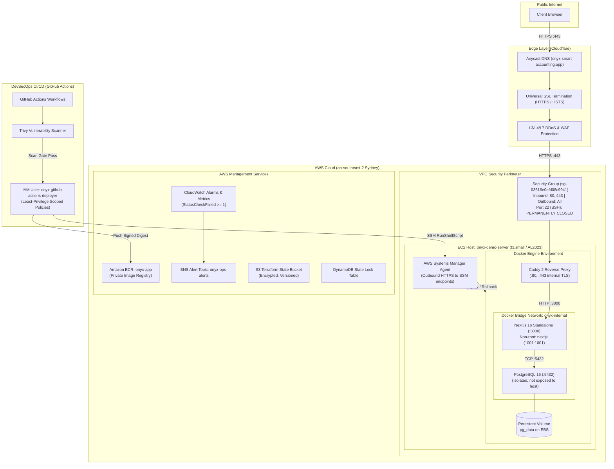

# OnYx Architecture & Security Design

This document details the system architecture, network boundaries, IAM security models, and trust perimeters for the **OnYx Smart Accounting** platform and its DevSecOps delivery pipeline.

---

## 1. High-Level Architecture Diagram

---

## 2. Ingress & Edge Protection

| Layer | Component | Function | Security Enforcement |
|---|---|---|---|
| **DNS & CDN** | Cloudflare Anycast | Authoritative DNS & Edge Routing | Proxied (`orange cloud`), masks origin EC2 public IP |
| **SSL / TLS** | Cloudflare Universal SSL | Edge TLS Termination | Enforces TLS 1.2+, modern cipher suites, and HTTPS redirection |
| **Origin TLS** | Caddy 2 Reverse Proxy | Local TLS & Ingress Routing | Generates internal trusted certificates; terminates ingress on ports 80/443; proxies to `http://app:3000` |
| **Firewall** | AWS Security Group | Network Packet Filtering | Inbound ports limited strictly to 80 and 443. Port 22 is **blocked** |

---

## 3. Container & Runtime Isolation

1. **Non-Root Execution**:
   - The application container runs as user `nextjs` (UID: 1001, GID: 1001).
   - Even if an application-layer vulnerability were exploited, the attacker does not possess root privileges inside the container.
2. **Minimalist Attack Surface**:
   - Built on `node:26-alpine`.
   - Node package managers (`npm`, `npx`, `corepack`) are purged from the production runner stage, eliminating transitive runtime supply-chain attack vectors.
3. **Network Isolation**:
   - The database (`onyx-prod-db`) is attached strictly to the private Docker bridge network `onyx-internal`.
   - The database port `5432` is **not published to the host** (`0.0.0.0`), preventing any direct external network access.
4. **Data Durability**:
   - Database tables are persisted to a named Docker volume (`onyx_pg_data`), surviving container restarts, image upgrades, and deployments.

---

## 4. Zero-SSH & Identity Architecture

### Why No SSH?
Traditional deployments rely on SSH keys (`.pem` files) stored on developer machines or GitHub secrets, with port 22 open to the internet. This exposes hosts to brute-force scans and credential exfiltration.

### The SSM Alternative:
* **Zero Inbound Ports**: The EC2 instance connects outbound to AWS Systems Manager endpoints over HTTPS (port 443).
* **IAM Authentication**: Deployments are authenticated using AWS IAM policies rather than SSH keys.
* **Audit Trail**: Every command executed via SSM Run Command or Session Manager is logged in AWS CloudTrail.

### Least-Privilege IAM CI/CD Credentials:
The GitHub Actions deployment user (`onyx-github-actions-deployer`) is restricted to two narrowly scoped policies:

1. **`onyx-cicd-ecr-push`**:
   - Allows `ecr:GetAuthorizationToken` (read-only token acquisition).
   - Allows `ecr:PutImage`, `ecr:UploadLayerPart`, `ecr:CompleteLayerUpload` **strictly** on `arn:aws:ecr:ap-southeast-2:797661819601:repository/onyx-app`.
   - Cannot delete images, create repositories, or access any other AWS service.

2. **`onyx-cicd-ssm-deploy`**:
   - Allows `ssm:SendCommand` **strictly** on instance `arn:aws:ec2:ap-southeast-2:797661819601:instance/i-00d2233bfd6f65be2` using document `AWS-RunShellScript`.
   - Allows `ec2:DescribeInstances` to dynamically resolve the server's public IP for smoke-testing.
   - Denied from modifying instance types, terminating instances, or accessing S3/IAM.

---

## 5. Deployment & Automated Rollback Mechanics

The deployment pipeline (`.github/workflows/deploy-demo.yml` and `scripts/deploy-demo.sh`) ensures zero-downtime, self-healing rollouts:

1. **Digest Resolution**: GitHub Actions captures the immutable SHA-256 digest (`@sha256:...`) from ECR, preventing tag-mutation race conditions.
2. **State Preservation**: The deployment script records the currently active image digest to `/opt/onyx/previous_image.txt` before pulling new containers.
3. **Atomic Re-creation**: Docker Compose pulls the new image and re-creates only changed containers.
4. **Automated Smoke Test**: The script queries `http://localhost:3000/api/health` every 2 seconds (up to 15 attempts).
5. **Automated Self-Healing Rollback**: If all 15 health checks fail, the script immediately rolls back the `.env` configuration to `previous_image.txt`, restarts the previous container, confirms health, and fails the CI/CD job with an exit code 1.

---

## 6. Threat Modeling & Trust Boundaries

| Boundary | Threat | Mitigation |
|---|---|---|
| **Public -> Host** | DDoS, Port Scans, SSH Exploits | Cloudflare proxying, AWS Security Group with port 22 permanently closed |
| **Client -> App** | Man-in-the-Middle (MitM) | End-to-end TLS (Cloudflare Universal SSL + Caddy internal TLS) |
| **Host -> App** | Container Breakout | Multi-stage distroless-like Alpine runner, non-root `nextjs` user |
| **App -> Database** | Unauthorized DB Access | DB port 5432 not exposed to host or internet; Docker network isolation |
| **CI/CD -> AWS** | Credential Theft / Over-privilege | Scoped IAM user constrained to single ECR repo and single EC2 instance |
| **Dependency -> App** | Vulnerable Packages (CVEs) | Automated Trivy scanner gate in CI failing builds on CRITICAL/HIGH vulnerabilities |

